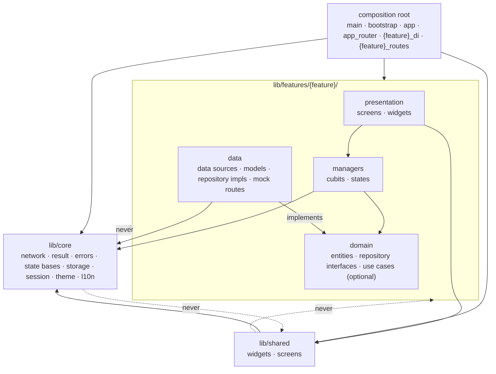
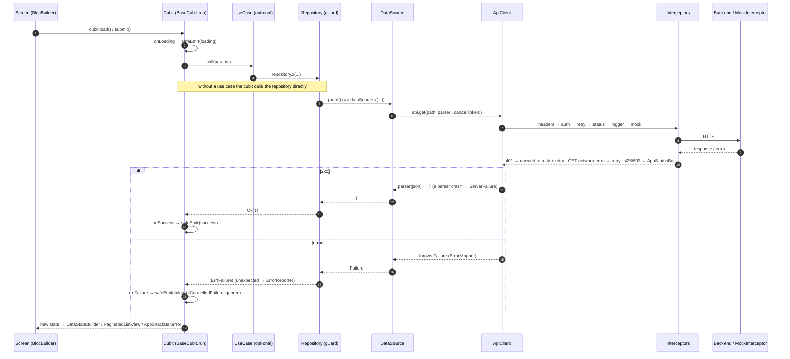
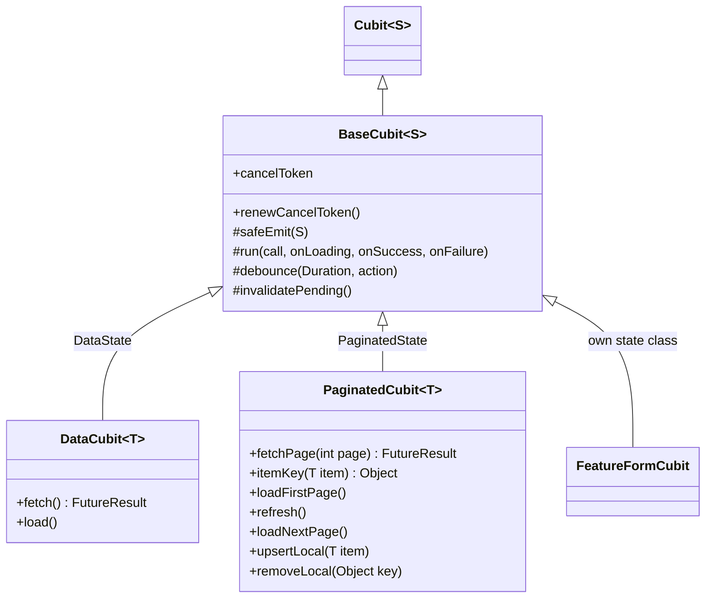
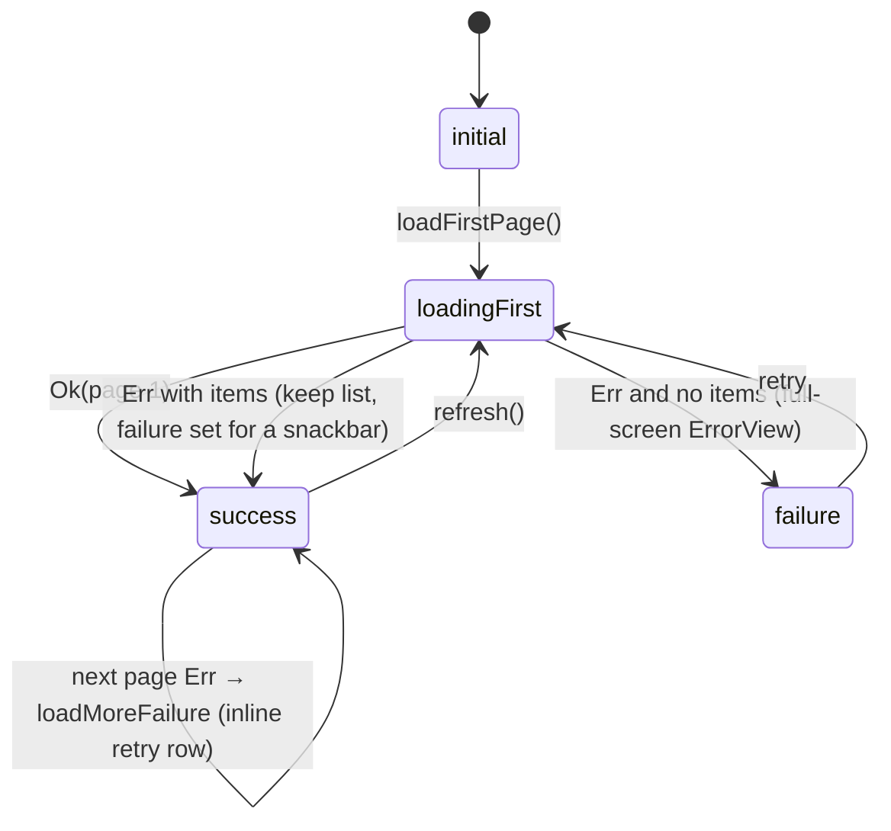
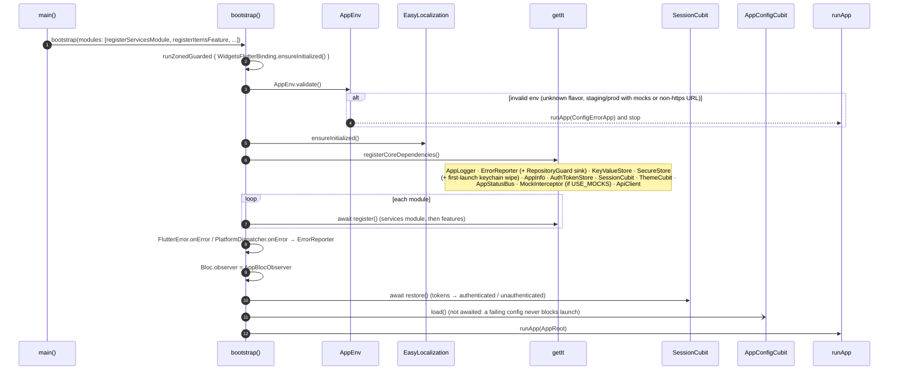
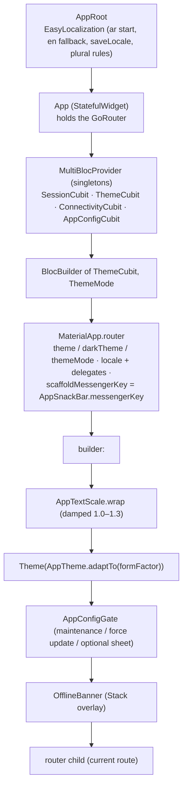
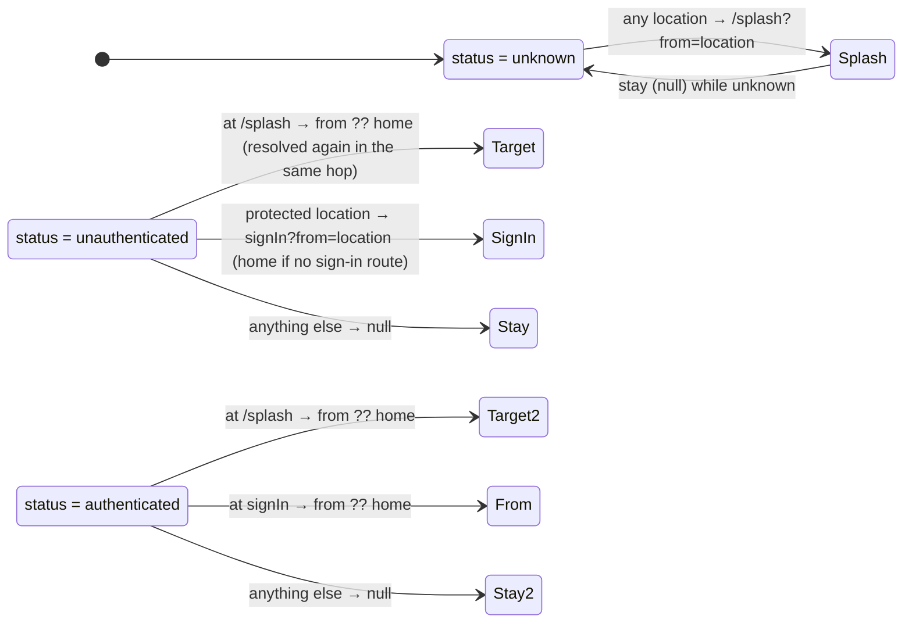
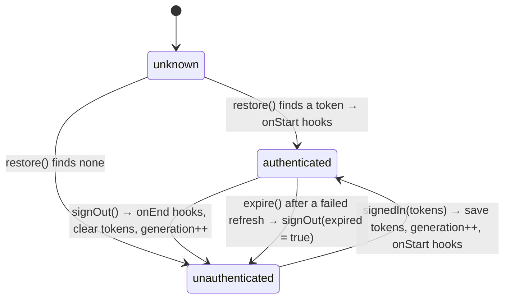
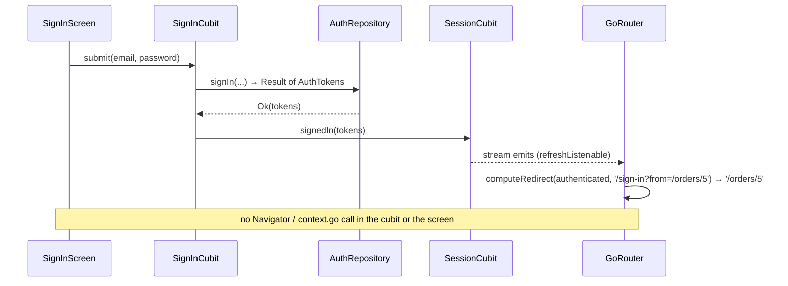
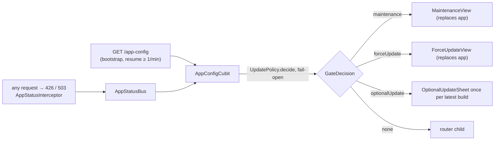

# Architecture

How `flutter_template` is put together: layers, data flow, state, startup, routing, session and
DI. Rules are summarised in [CONVENTIONS.md](CONVENTIONS.md). APIs are in
[SERVICES.md](SERVICES.md) and [WIDGETS.md](WIDGETS.md). The folder map is in
[FOLDER_STRUCTURE.md](FOLDER_STRUCTURE.md).

Contents: [Layers](#layers) · [Folder overview](#folder-overview) · [Data flow](#data-flow) ·
[State](#state) · [Pagination](#pagination) · [Startup](#startup) · [App root](#app-root) ·
[Routing](#routing) · [Session](#session) · [App gate](#app-gate) ·
[Dependency injection](#dependency-injection) · [Use cases](#use-cases) · [Features](#features)

---

## Layers

Feature-first clean architecture. **Data and presentation are required. The domain layer holds
entities and repository interfaces, and use cases are optional** (corsa's rule, decision C5).

| Layer | Folder (per feature) | Contains | May import |
|---|---|---|---|
| Presentation | `presentation/screens`, `presentation/widgets` | Screens, feature widgets, `BlocBuilder`/`BlocListener` | managers, domain, `shared/`, `core/` |
| Managers | `presentation/managers` | Cubits + states (`BaseCubit`, `DataCubit`, `PaginatedCubit`) | domain, `core/` |
| Domain | `domain/entities`, `domain/repositories`, `domain/use_cases` (optional) | Pure Dart entities, repository **interfaces**, use cases that hold logic | `core/result`, `core/errors`, `core/pagination/page.dart`, `core/utils`, `equatable`, `LocaleKeys` for rule messages. **Never** `package:flutter`, `dio`, `bloc`/`flutter_bloc`, `go_router`, `get_it`, the feature's `data/` or `presentation/` |
| Data | `data/data_sources`, `data/models`, `data/repositories`, `data/mock` | `ApiClient` calls, JSON models, repository **implementations** (`with RepositoryGuard`), mock routes | domain, `core/` |
| Core | `lib/core/` | Infrastructure: network, errors, result, state bases, storage, session, theme, responsive, l10n, services | `core/` only |
| Shared | `lib/shared/` | Reusable widgets and app-level screens | `core/` |
| Composition | `main.dart`, `bootstrap.dart`, `app.dart`, `app_router.dart`, `<feature>_di.dart`, `<feature>_routes.dart` | Wiring | everything |



Forbidden imports (decision D9): `core → shared`, `core → features`, `shared → features`, and one
feature's internals → another feature. `test/policy/architecture_test.dart` enforces these rules,
the domain bans and "getIt only in composition code". To share something between features, move it to `core/`
(logic) or `shared/` (UI), or depend on the other feature's **domain interface** registered in DI.

## Folder overview

```
lib/
├── main.dart            → bootstrap(modules: [...])
├── bootstrap.dart       → startup sequence (composition root)
├── app.dart             → AppRoot (localization) + App (providers, MaterialApp.router, builder)
├── app_router.dart      → GoRouter: redirect, shell, feature routes
├── core/                → infrastructure, no UI except theme
├── shared/              → reusable widgets + app-level screens
└── features/<feature>/  → data / domain / presentation + <feature>_di.dart + <feature>_routes.dart
```

The full annotated tree is in [FOLDER_STRUCTURE.md](FOLDER_STRUCTURE.md).

## Data flow

A request from a screen to the API and back. Every arrow back carries either a value or a
`Failure`, and nothing throws past the repository.



| Step | Owner | Contract |
|---|---|---|
| Data source | `data/data_sources/*` | Calls `ApiClient` (or a local store). **Throws `Failure`**. Parses with the `parser:` callback and the [JSON helpers](SERVICES.md#json-helpers) |
| Repository | `data/repositories/*_impl.dart` | `with RepositoryGuard`. **Returns `Result<T>`**, maps models to entities, never throws |
| Use case (optional) | `domain/use_cases/*` | Only when it holds logic (combine repositories, enforce a rule). Returns `Result<T>` |
| Cubit | `presentation/managers/*` | `run(call, onLoading:, onSuccess:, onFailure:)`. Late or stale results are dropped |
| UI | `presentation/screens/*` | Renders state; shows `failure.displayMessage` |

See [SERVICES.md#apiclient](SERVICES.md#apiclient), [SERVICES.md#failures](SERVICES.md#failures)
and [CONVENTIONS.md#error-handling](CONVENTIONS.md#error-handling).

## State

One base class, `BaseCubit<S>` (`lib/core/presentation/base_cubit.dart`), and two generic
specialisations. No feature needs a second base (the house style had two parallel bases in 8 apps,
decision C3).



| Need | Use |
|---|---|
| Load one thing (details, profile) | `DataCubit<T>` + `DataState<T>` + `DataStateBuilder<T>` |
| Infinite list, search | `PaginatedCubit<T>` + `PaginatedState<T>` + `PaginatedListView<T>` |
| Forms, multi-step flows, anything custom | `BaseCubit<MyState>` with an immutable `Equatable` state and `copyWith` (with `clearX` flags) |

What `run` guarantees:
- **Stale-result guard**: each call takes a ticket. A result that arrives after a newer `run`,
  after `invalidatePending()` or after `close()` is dropped (from chinaparts-customer's epoch guard
  and chinaparts-seller's request generations).
- **Cancellation**: `cancelToken` is cancelled on `close()`. `CancelledFailure` never reaches
  `onFailure`, so a closed screen never shows "error".
- **No throw escapes**: an exception from `call` becomes `UnknownFailure`.
- It is `@nonVirtual`, and overriding it is an analyzer **error**.

`DataState.loading()` and `failed()` keep the previous `data`, so refreshes never blank the screen
(`isRefreshing`). Cubits never navigate: they expose state, and screens react in a `BlocListener`.

## Pagination

`lib/core/pagination/` + `lib/shared/widgets/lists/paginated_list_view.dart`.



- `fetchPage(int page)` is 1-based and returns `Result<Page<T>>`. `Page.fromJson` reads
  Laravel-style `{data, meta: {current_page, last_page, total}}`, the same keys at the root, `items`,
  or an explicit `has_more`.
- `loadNextPage()` is a no-op unless `status == success && hasMore && !isLoadingMore`, so the view
  can call it on every scroll event.
- Items are de-duplicated by `itemKey`, so an item that shifts between pages is shown once.
- `PaginatedListView` loads more within 300 px or 80 % of the end. It **fills the viewport**: if
  page 1 doesn't scroll (tablet, landscape), it loads page 2 right away, but never after a failure,
  so it can't loop.
- Search: `renewCancelToken()` then `loadFirstPage()`. The old request is cancelled and its result
  dropped.
- Local edits: `upsertLocal(item)` / `removeLocal(id)` after create, edit or delete. You don't need
  to reload.

## Startup

`lib/main.dart` → `bootstrap(modules: [...])` (`lib/bootstrap.dart`). This is the composition root
and the only place that wires features to core.



Notes:
- **Ordered and awaited.** Every registration is awaited, and features register after core (brgr,
  instaops and chinaparts-seller didn't await theirs).
- **Fail-closed config, fail-open remote config**: a broken build configuration stops at
  `ConfigErrorApp`, but a missing or failed `/app-config` never blocks users.
- **No orientation lock** is set (see [CONVENTIONS.md#responsive](CONVENTIONS.md#responsive)).
- Opt-in modules (Firebase, Crashlytics, FCM) initialise **between** `EasyLocalization` and
  `registerCoreDependencies`. See the recipes in [SERVICES.md](SERVICES.md#optional-recipes).
- Errors before DI exists are printed with `debugPrint`. After that they go to `ErrorReporter`.

## App root

`lib/app.dart`.



- Everything in `builder` applies to **every** route, dialog and sheet, and sits above the
  `Navigator`. The gate can't be bypassed by a deep link, and the banner never rebuilds the
  routes.
- `CurrentLocale.value = context.locale` on every build keeps `Accept-Language` and `AppFormat` in
  sync with the UI without a `BuildContext`.
- `MaterialApp` is **not** keyed by locale. Changing the language relocalises in place, with no
  full-tree rebuild (a chinaparts-customer smell).
- The type scale grows slightly on tablets (`AppTheme.adaptTo`). The user's font setting is damped
  separately.

## Routing

go_router. Files: `lib/app_router.dart` (assembly), `lib/core/router/app_routes.dart` (app paths,
root navigator key), `redirect.dart` (pure redirect), `router_refresh_stream.dart`, and each
feature's `<feature>_routes.dart`.

```dart
GoRouter(
  navigatorKey: AppRoutes.rootNavigatorKey,
  initialLocation: AppRoutes.home,
  refreshListenable: RouterRefreshStream([session.stream]),
  redirect: (context, state) => computeRedirect(session.state.status, state.uri.toString(), _redirectConfig),
  errorBuilder: (context, state) => const NotFoundScreen(),
  routes: [
    GoRoute(path: AppRoutes.splash, ...),
    StatefulShellRoute.indexedStack(               // tabs keep their own stacks
      builder: (context, state, shell) => HomeShell(navigationShell: shell),
      branches: [
        StatefulShellBranch(routes: ItemsRoutes.routes(rootNavigatorKey: AppRoutes.rootNavigatorKey)), // '/'
        StatefulShellBranch(routes: [GoRoute(path: AppRoutes.settings, ...)]),
      ],
    ),
  ],
);
```

Rules:
- **IDs in paths, never objects in `extra`.** `/items/:id` → `state.pathParameters['id']!`.
  Deep links, restoration and web URLs then just work. `state.extra as X` crashed on restore in
  10 of 12 source projects. Pass simple filters as query parameters.
- **No extra casts.** Route builders read params, resolve cubits with `getIt`, and build the
  screen.
- **The redirect is pure** (`computeRedirect(status, location, config)`): no `BuildContext`, no
  async, no side effects. It is unit-tested in `test/core/router/redirect_test.dart`. Every branch
  returns `null` for locations it is already satisfied by, so one hop always settles (no
  ping-pong).
- Each feature exposes `abstract final class XRoutes` with path constants, path builders
  (`details(id)`) and `routes(...)`. `create_feature.dart` generates `routes()`. Add a
  `{required rootNavigatorKey}` parameter, as `ItemsRoutes` does, when a sub-route must cover the
  tab bar. Full-screen flows (create forms, viewers) use `parentNavigatorKey: rootNavigatorKey`.
- Tabs: add a `StatefulShellBranch` in `app_router.dart` **and** an `AdaptiveDestination` in
  `home_shell.dart`, in the same order.
- Use `context.go` for top-level jumps and `context.push` for drill-down.

### Redirect state machine

`RedirectConfig(splash: '/splash', home: '/', signIn: null, protectedPrefixes: [])`. Set `signIn`
and `protectedPrefixes` when the app gets an auth feature.



| Status | Location | Redirect |
|---|---|---|
| unknown | `/splash` | stay |
| unknown | anything else | `/splash?from=<location>` (the cold-start deep link is kept) |
| known | `/splash?from=x` | `x` (or home), itself resolved, so a protected `x` while signed out goes straight to sign-in |
| unauthenticated | protected prefix | `signIn?from=<location>`, or home when there is no sign-in route |
| authenticated | sign-in route | `from` or home |
| any | anything else | stay |

`refreshListenable` re-runs the redirect on every `SessionCubit` change. Signing in or out
therefore needs **no navigation code**.

Sources: baytna `app/router/*` (status redirect, refreshListenable, StatefulShellRoute); markspulse
`redirect.dart` (pure, tested); corsa-customer (errorBuilder, cold-start deep link via the splash
`from`); lexa-student (multi-stream refresh).

## Session

`lib/core/session/session_cubit.dart`. The router depends only on `SessionState.status`. See
[SERVICES.md#session](SERVICES.md#session) for the API.





- **Single-flight sign-out**: concurrent `signOut`/`expire` calls share one run, and a late
  sign-out can't wipe a newer session's tokens.
- **Hooks** (`addHooks(onStart:, onEnd:)`) let features react (clear caches, register or
  unregister the push token, `PendingLink.clear()`, `ErrorReporter.setUserId`) without core
  importing them. A failing hook never blocks the transition.
- **`generation`** changes on every sign-in/out. Key per-user widget subtrees with it.
- Being **offline never signs out**. Only a failed refresh or an explicit sign-out does. A 403
  never signs out.

## App gate

Maintenance, force update and optional update. They come from `GET /app-config` and from live 426
or 503 responses on any endpoint. Details: [SERVICES.md#app-config](SERVICES.md#app-config) and
[WIDGETS.md#app-gate](WIDGETS.md#app-gate).



## Dependency injection

get_it, manual (no codegen), one registration function per module (decision C4). Files:
`lib/core/di/injector.dart` (`getIt`, `registerCoreDependencies`), `lib/core/di/services_module.dart`
(`registerServicesModule`) and `lib/features/<feature>/<feature>_di.dart`
(`register<Feature>Feature`).

| Registration | Kind | Why |
|---|---|---|
| `AppLogger`, `ErrorReporter`, `KeyValueStore`, `SecureStore`, `AppInfo`, `AuthTokenStore`, `AppStatusBus`, `MockInterceptor`, `ApiClient` | singleton (core, created eagerly in order) | Needed by everything; created once, awaited |
| `SessionCubit`, `ThemeCubit`, `ConnectivityCubit`, `AppConfigCubit` | singleton | App-wide state provided at the root with `BlocProvider.value` |
| `UrlService`, `PermissionService`, `ImagePickerService`, `PushService`, `NotificationLinkResolver`, `PendingLink`, `AppConfigRepository` | lazySingleton | Services: created on first use |
| Feature data sources and repositories | lazySingleton | Stateless, shared |
| Feature cubits | **factory** (`registerFactory` / `registerFactoryParam`) | A fresh cubit per screen, closed by its `BlocProvider` |

```dart
// lib/features/sample_feature/items_di.dart (abridged)
Future<void> registerItemsFeature() async {
  getIt
    ..registerLazySingleton<ItemsRemoteDataSource>(() => ItemsRemoteDataSource(getIt<ApiClient>()))
    ..registerLazySingleton<ItemsRepository>(() => ItemsRepositoryImpl(getIt<ItemsRemoteDataSource>()))
    ..registerLazySingleton<CreateItemUseCase>(() => CreateItemUseCase(getIt<ItemsRepository>()))
    ..registerFactory<ItemsListCubit>(() => ItemsListCubit(getIt<ItemsRepository>()))
    ..registerFactoryParam<ItemDetailsCubit, String, void>((id, _) => ItemDetailsCubit(getIt<ItemsRepository>(), id: id))
    ..registerFactory<CreateItemCubit>(() => CreateItemCubit(getIt<CreateItemUseCase>()));

  if (getIt.isRegistered<MockInterceptor>()) registerItemsMockApi(getIt<MockInterceptor>());

  if (getIt.isRegistered<NotificationLinkResolver>()) {
    getIt<NotificationLinkResolver>().register('item', (payload) {
      final id = payload['id'];
      return id == null || '$id'.trim().isEmpty ? null : ItemsRoutes.details('$id');
    });
  }
}
```

Rules:
- **Constructor injection only.** Classes never call `getIt`. Only `*_di.dart`, `*_routes.dart`,
  `lib/core/di/` and the composition root (`main.dart`, `bootstrap.dart`, `app.dart`,
  `app_router.dart`) do, for example
  `BlocProvider(create: (_) => getIt<ItemsListCubit>()..loadFirstPage())` in a route builder.
  Enforced by `test/policy/architecture_test.dart`.
- Registrations are **awaited**, contain **no platform calls** inside factories, and are
  **overridable for tests**: `registerCoreDependencies(keyValueStore:, secureStore:, appInfo:,
  errorReporter:)`, `registerServicesModule(connectivityService:, permissionService:, pushService:,
  urlService:, startConnectivity:)`, and `resetDependencies()` in `tearDown`.
- Register against the **interface** (`ItemsRepository`), never the implementation, so tests and
  other features depend on the contract.
- New feature: add `registerXFeature` to the `modules` list in `main.dart`. `create_feature.dart`
  prints the exact line.

Sources: corsa-customer `core/services/di_container.dart` + `features_di.dart` (core/features split,
lazySingleton/factory rules, awaited). Rejected: injectable codegen (baytna), no locator
(markspulse/lexa), locator lookups inside base classes.

## Use cases

The domain layer always has **entities** and **repository interfaces**. Use cases are
**optional** (decision C5, corsa's `create_feature.dart --use-cases` rule):

| Add a use case when | Don't, when |
|---|---|
| A business rule must hold whatever screen calls it (validation the backend doesn't do, limits, permissions by role) | The cubit just loads or saves through one repository call |
| Several repositories or services have to be orchestrated (upload, then create, then refresh) | It would only forward arguments (a "pass-through" use case) |
| The same flow is triggered from several cubits | |

Shape: one public `call(...)` that returns `Future<Result<T>>`, constructor-injected repositories,
and no Flutter, Dio or UI side effects. Register it as a lazySingleton.

```dart
// lib/features/sample_feature/domain/use_cases/create_item_use_case.dart (abridged)
class CreateItemUseCase {
  CreateItemUseCase(this._repository);
  final ItemsRepository _repository;
  static const int minTitleLength = 3;

  Future<Result<Item>> call(CreateItemInput input) async {
    final clean = input.trimmed();
    if (clean.title.runes.length < minTitleLength) {
      // Same shape as a backend 422, so the form shows it under the field.
      return Err(ValidationFailure(code: 'title_too_short', fieldErrors: {
        'title': [LocaleKeys.items_title_too_short.tr(namedArgs: {'min': AppFormat.number(minTitleLength)})],
      }));
    }
    return _repository.create(clean);
  }
}
```

In the sample feature, `CreateItemCubit` goes through `CreateItemUseCase`, while
`ItemsListCubit` and `ItemDetailsCubit` call `ItemsRepository` directly. Both are correct. The
domain never imports Dio: the cubit's `cancelToken` crosses the domain boundary as `Object?`
(`ItemsRepository.fetchPage(page, {query, Object? cancelToken})`), and the data layer narrows it
back to a `CancelToken`.

For role-based apps where every operation needs an authorization check (markspulse, lexa), make
**every** operation a guarded use case instead. Document that choice in the project's CLAUDE.md.

## Features

A feature is a vertical slice under `lib/features/<feature>/` with the layers above plus two
composition files:

```
lib/features/<feature>/
├── <feature>_di.dart          register<Feature>Feature(): data sources, repositories, use cases, cubits,
│                              mock routes, notification links, session hooks
├── <feature>_routes.dart      abstract final class <Feature>Routes: paths, path builders, routes(...)
├── data/   data_sources/ · models/ · repositories/ · mock/
├── domain/ entities/ · repositories/ · use_cases/ (optional)
└── presentation/ managers/ · screens/ · widgets/
```

### The sample feature ("items")

`lib/features/sample_feature/` is the reference implementation. It runs on the mock backend with
no server.

| Concern | Where | Shows |
|---|---|---|
| List + search + infinite scroll | `ItemsListCubit` (`PaginatedCubit<Item>`), `ItemsListScreen` | Debounced search that cancels the previous request; `PaginatedListView` as a list on phones and a grid when two 280 px tiles fit; refresh failure → snackbar; empty vs "no results" |
| Details | `ItemDetailsCubit` (`DataCubit<Item>`), `ItemDetailsScreen` | `DataStateBuilder`; stacked on phones; `AdaptiveTwoPane` (image │ info) on tablets and unfolded foldables, split at the hinge; hero image |
| Create form | `CreateItemUseCase`, `CreateItemCubit` + `CreateItemState`, `CreateItemScreen` | Client validators, the domain rule, and server **422 field errors under the fields** (`state.fieldError('title')`); general failures in a snackbar; `DirtyGuard`; busy submit; pops with the created item, which `upsertLocal` adds to the list |
| Data | `ItemsRemoteDataSource` (`ItemsEndpoints`), `ItemModel` (tolerant JSON, bad rows skipped), `ItemsRepositoryImpl with RepositoryGuard` | |
| Mock backend | `data/mock/items_mock_api.dart` → `registerItemsMockApi(mock)` over `assets/mocks/items.json` | Paging + `q` search, 404, 422 in the request's language |
| Routes | `ItemsRoutes`: `list` = `/`, `create` = `/items/new` (root navigator, full screen), `details(id)` = `/items/:id` | IDs in the path; cubits created in the route builder |
| Push link | `{"type": "item", "id": 5}` → `ItemsRoutes.details('5')` | Registered in `items_di.dart` |

### Adding a feature

1. `dart run tool/create_feature.dart orders` (add `--use-cases` for a `domain/use_cases/` folder),
   or run the [`/new-feature`](../.claude/commands/new-feature.md) slash command, which does the
   whole procedure below.
2. Fill in the layers following the items pattern: entity → repository interface → model + data
   source (+ mock routes) → repository impl → cubit(s) → screens.
3. Add `orders.*` translations to `ar.json` **and** `en.json`, then run `./tool/gen_locale_keys.sh`.
4. Wire it with the lines the scaffolder prints: `registerOrdersFeature` in `main.dart`'s
   `modules`, and `OrdersRoutes.routes(...)` in `app_router.dart` (a new shell branch +
   destination in `home_shell.dart`, or nested under an existing route).
5. Write tests: repository against `MockInterceptor`, cubit with `bloc_test`, screens in the layout
   matrix.
6. Run `dart run tool/check_translations.dart`, `dart format lib test tool`,
   `flutter analyze --fatal-infos` and `flutter test`. All of them must be green.
